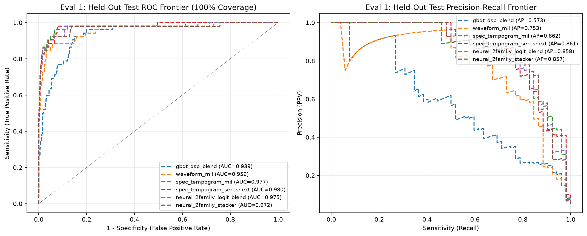
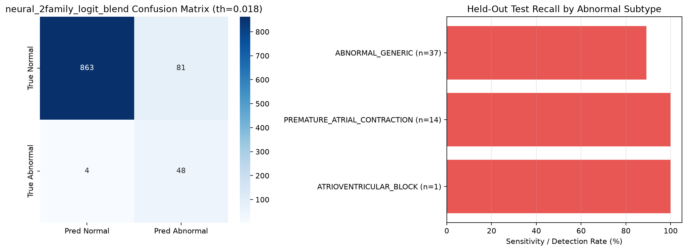
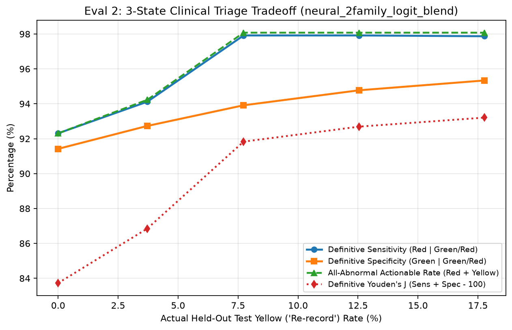

# Fetal Doppler Heart-Sound Screening (`v0_20261122_nowarmstart`)

---

# Part 1: Human-Readable Summary

## 1. What We Did

We built a training and evaluation pipeline in `ultrasound-heart-v2` to classify **Abnormal** vs. **Normal** fetal heart rhythms from raw handheld Doppler ultrasound audio (`4,000 Hz`).

Before training models, we audited the raw recordings and labels in GCP project `heartsounds` and applied four curation steps:

1. **Deduplicated exact waveforms:** Of `8,284` rows across the 17 legacy 4 kHz pickle shards, `1,260` were exact duplicate waveforms, leaving `7,024` unique recordings.
2. **Repaired case-sensitive label mismatches:** `113` unique recordings under `normal/normals-20241116/` contained uppercase `ABNORMAL`, `ABNOMRAL`, or `TOO FAST` in their filenames (e.g., `6.29.24 pm 24 wks ABNORMAL.mp3`) and had previously been labeled `NORMAL`. Two recordings under `abnormal/` were named `Normal...` / `Repeat was normal` and were relabeled `NORMAL`.
3. **Quarantined conflicting and non-diagnostic files:** `17` duplicate waveforms had conflicting folder labels without a filename override, and `2` were labeled `NON-DIAGNOSTIC`. These `19` recordings were placed in `quarantine.parquet` and excluded from training and test splits.
4. **Grouped splits by patient/session:** The `7,005` usable recordings were split into `347` patient/session groups with zero group overlap across the 5 cross-validation folds (`6,009` recordings, `301` groups) and the held-out test set (`996` recordings, `46` groups: `52` Abnormal, `944` Normal).

All curated datasets, raw-to-curated mappings, features, predictions, and plots are stored in **`gs://data-processed-dualregion/v2_curated/`**, linking each row back to its source URI in `gs://data-raw-dualregion/`. GPU jobs ran on Beaker via [`.agents/skills/beaker/SKILL.md`](../.agents/skills/beaker/SKILL.md) and [`scripts/launch.py`](../scripts/launch.py) under a `<= 2` concurrent GPU limit.

---

## 2. What We Tried and How It Worked

Abnormal fetal arrhythmias (such as premature atrial contractions, pauses, or conduction blocks) can appear for 1–3 seconds inside 30-to-180-second Doppler clips and make up `~5.7%` of the dataset. All model selection, ensembling, and threshold calibration used 5-fold patient-grouped cross-validation (`6,009` recordings across `301` patient groups); the `996`-recording test set (`46` patient groups) was used only for final evaluation.

In this initial `v0` pass (no hyperparameter sweeps or audio-pretrained foundation models yet), we tested three modeling approaches:

1. **Hand-crafted DSP features + Gradient-Boosted Trees (CPU baseline):**  
   Extracted `61` duration-invariant cardiac/spectral/HRV features from each 4 kHz waveform and trained Logistic Regression, XGBoost, and LightGBM.
2. **1D Raw-Waveform Neural Network (1 completed variant, `1.47M` params, trained from scratch):**  
   Processes the raw 4,000 Hz waveform alongside a multi-band energy envelope through dilated 1D ConvNeXt blocks (`250 Hz`), pools `8x` down to `31.25 Hz` (~14 frames/heartbeat), runs a 2-layer bidirectional GRU, and aggregates over time with gated-attention Multiple-Instance Learning (MIL) pooling. *(An earlier 1D run with the BiGRU at `250 Hz` was canceled at `fold_0` epoch 15 because ~4 min/epoch would have exceeded the `4h` job timeout; adding the `8x` pool sped it up ~6x and increased `fold_0` ROC-AUC from `0.902` to `0.937`.)*
3. **2D Spectrogram + Tempogram Neural Networks (2 variants):**  
   Converts each 4,000 Hz clip on-GPU into a 3-channel 2D image: a fine-time Log-Mel spectrogram (`16 ms` window), a fine-frequency Log-Mel spectrogram (`64 ms` window), and a sliding-window autocorrelation **Tempogram** (`0.24s–1.50s` lags). Using this same frontend and temporal MIL head, we trained two ImageNet-pretrained backbones: **`ConvNeXt-Small`** (`52.1M` params) and **`SE-ResNeXt-50`** (`12.8M` params). *(An initial `SE-ResNeXt-50` run had a hardcoded stride-16 mask bug that masked out the second half of clips for stride-8 backbones; fixing the mask stride in commit `cc36dbe` and rerunning raised `SE-ResNeXt-50` OOF ROC-AUC from `0.9115` to `0.9357` and OOF PR-AUC from `0.7468` to `0.7608`.)*

---

## 3. What Actually Happened (Performance Evaluation)

### The Main Story
1. **Hand-crafted DSP + GBDT was much weaker than the neural models and added no lift to the ensemble.**  
   LightGBM/XGBoost reached `0.856` OOF ROC-AUC / `0.404` OOF PR-AUC (`0.942` / `0.574` on test), producing too many false positives. When combined with the neural models, the ensemble gave GBDT near-zero weight (`3%` in a weighted blend, `-0.086` in logistic stacking), and dropping GBDT entirely gave slightly higher OOF performance (`0.9707 / 0.8291` without GBDT vs. `0.9704 / 0.8286` with GBDT). For classification, DSP + GBDT can be dropped; only the single autocorrelation periodicity score (`quality_r_peak_mean`) is used as an independent signal-quality input in 3-state re-record triage.
2. **The 1D waveform model and the 2D spectrogram+tempogram models had complementary strengths across folds.**  
   - The **1D waveform model** was the most consistent standalone model across cross-validation (`0.954` OOF ROC-AUC / `0.768` OOF PR-AUC). On the hardest validation fold (`fold_1`, which contains `5` `TOO_FAST` recordings), it scored `0.955` ROC-AUC while the two 2D models scored `0.889` (`ConvNeXt-Small`) and `0.898` (`SE-ResNeXt-50`).
   - The **2D spectrogram+tempogram models** were stronger on the other folds (`fold_0`, `fold_2`, `fold_3`, `fold_4`) and on the held-out test set (`0.977–0.980` test ROC-AUC, `0.861–0.862` test PR-AUC vs. `0.959 / 0.753` for 1D alone).
3. **The best overall model is a weighted log-odds average of the 3 neural networks only (`45%` 1D waveform + `30%` 2D ConvNeXt-Small + `25%` 2D SE-ResNeXt-50).**  
   Combining the 1D and 2D neural models raised cross-validation across all 301 dev patient groups from `0.954` to **`0.9707` OOF ROC-AUC** and from `0.770` to **`0.8291` OOF PR-AUC** (`+0.059` PR-AUC over the best single model). This fixed-weight neural blend (`neural_2family_logit_blend`) also outperformed the logistic regression stacker on OOF (`0.9707 / 0.8291` vs. `0.9694 / 0.8296`).
4. **Note on held-out test variance (`n = 52` abnormal clips):**  
   On the smaller 46-patient held-out test set, standalone `SE-ResNeXt-50` (`0.9798` ROC-AUC / `0.8607` PR-AUC), standalone `ConvNeXt-Small` (`0.9770 / 0.8619`), and the 2D pair (`0.9785 / 0.8710`) scored slightly higher on test ROC-AUC than the 1D+2D neural blend (`0.9745 / 0.8583`) — a difference inside the 95% patient-cluster bootstrap CI (`[0.967, 0.992]`). Across the 301-patient cross-validation set, the 1D+2D blend is stronger because it covers the 2D models' weaker performance on `fold_1`.

### Evaluation 1: 100% Coverage Binary Classification (`neural_2family_logit_blend`)

On the `996` held-out test recordings across `46` disjoint patient groups (`52` Abnormal, `944` Normal), the neural-only 1D+2D weighted log-odds blend (`45%` 1D + `30%` 2D ConvNeXt + `25%` 2D SE-ResNeXt) achieved:

| Metric (Held-Out Test, `n = 996`) | `neural_2family_logit_blend` | 95% Patient-Cluster Bootstrap CI |
| :--- | :---: | :---: |
| **ROC-AUC** | `0.9745` | `[0.9666, 0.9920]` |
| **PR-AUC (Average Precision)** | `0.8583` | `[0.6352, 0.9319]` |
| **Sensitivity** (at OOF `max_youden_j` cutoff) | `92.31%` (`48 / 52`) | `[83.33%, 100.00%]` |
| **Specificity** (at OOF `max_youden_j` cutoff) | `91.42%` (`863 / 944`) | `[88.54%, 94.63%]` |
| **Youden's $J$ / Balanced Accuracy** | `0.8373` / `91.86%` | `[0.7406, 0.9109]` |
| **Negative Predictive Value (NPV)** | `99.54%` (`863 / 867`) | — |
| **Equal Sens/Spec Operating Point** | Sens `92.31%` / Spec `92.16%` | — |
| **Max-$F_1$ Operating Point** | Sens `84.62%` / Spec `97.99%` / $F_1$ `0.765` | — |

- **By clinical subtype (at `max_youden_j`):** Detected `14 / 14` (`100%`) Premature Atrial Contractions (`PAC`), `1 / 1` (`100%`) Atrioventricular Block (`AVB`), and `33 / 37` (`89.2%`) `ABNORMAL_GENERIC` recordings.

### Evaluation 2: 3-State Clinical Triage (`Green: Normal` / `Yellow: Re-record` / `Red: Abnormal`)

Adding a `Yellow (Re-record)` band avoids forcing binary predictions on low-periodicity or borderline recordings. Using an OOF-calibrated uncertainty score combining `neural_2family_logit_blend`'s margin from the decision threshold with DSP periodicity quality (`quality_r_peak_mean`):

- **At `7.7%` actual test Yellow rate** (`77 / 996` recordings routed to `Yellow`; `92.3%` definitive coverage):
  - Definitive Sensitivity increased from `92.3%` to `97.9%` (`47 / 48` definitive abnormal detected; `4` abnormal routed to `Yellow`, `1` classified `Green`; `98.1%` Red+Yellow actionable rate).
  - Definitive Specificity increased from `91.4%` to `93.9%`.
  - Definitive Youden's $J$ increased from `0.837` to `0.918` (Balanced Accuracy `95.9%`).
- **At `12.6%` actual test Yellow rate** (`125 / 996` recordings routed to `Yellow`; `87.5%` definitive coverage):
  - Definitive Sensitivity remained `97.9%` (`47 / 48`; `4` abnormal in `Yellow`, `1` in `Green`; `98.1%` actionable rate) while Definitive Specificity increased to `94.8%` (Youden's $J = 0.927$, Balanced Accuracy `96.4%`).
- **Quarantined `NON_DIAGNOSTIC` recordings (`n = 2`):** `0 / 2` were classified `GREEN_NORMAL` (`1` routed to `YELLOW_RERECORD`, `1` to `RED_ABNORMAL`).

---

# Part 2: Detailed Technical Reference & Audit Trail

## 1. Curated Dataset Provenance & GCP Storage (`project=heartsounds`)

All curated datasets, features, and predictions are stored in **`gs://data-processed-dualregion/v2_curated/`** and mirrored to Beaker dataset `01M833C8GPEQDGDEDEYD928FDK` (SHA-256 verified inside the H200 container via `--hello` probe `01M833ZA8Q6SP8ER4TA33Z9AB9`):

| GCS Object (`gs://data-processed-dualregion/v2_curated/...`) | Size | Purpose & Contents |
| :--- | ---: | :--- |
| `README.md` & `curation_report.json` | 5.1 KiB | Curation rules, split counts, label-repair summary, and SHA-256 checksums |
| `manifest.csv` / `manifest.parquet` | 2.4 MiB / 712 KiB | All `7,024` unique waveforms: `recording_id`, `waveform_sha256`, `primary_raw_gcs_uri`, `patient_group`, `raw_label`, `curated_label`, `label_change_reason`, `curated_subtype`, `split`, `duration_s` |
| `raw_row_mapping.csv` | 1.4 MiB | `8,284`-row lineage mapping every legacy pickle row to its deduplicated `recording_id` |
| `train_val_folds.parquet` | 1.53 GiB | `6,009` 4,000 Hz `float32` waveforms (`5,664` Normal, `345` Abnormal [`5.74%`]) across `301` patient groups (`fold_0..fold_4`) |
| `test.parquet` | 211 MiB | `996` 4,000 Hz `float32` waveforms (`944` Normal, `52` Abnormal [`5.22%`]) across `46` disjoint patient groups |
| `quarantine.parquet` | 6.1 MiB | `19` quarantined waveforms (`17` unmarked cross-folder conflicts, `2` `NON_DIAGNOSTIC`) |
| `dsp_features.parquet` | 3.5 MiB | `61` duration-invariant DSP/HRV/spectral/ectopy features across all `7,024` waveforms |
| `predictions/oof_predictions.{csv,parquet}` | 2.0 MiB / 995 KiB | OOF probabilities from all models + `neural_2family_logit_blend` binary & 3-state triage calls + `primary_raw_gcs_uri` |
| `predictions/test_predictions.{csv,parquet}` | 322 KiB / 210 KiB | Held-out test probabilities from all models + `neural_2family_logit_blend` binary & 3-state triage calls + `primary_raw_gcs_uri` |
| `predictions/evaluation_report.json` | 307 KiB | Machine-readable Evaluation 1 & Evaluation 2 metrics, 95% CIs, confusion matrices, and triage curves |
| `predictions/*.png` | 422 KiB | All 3 diagnostic plots embedded above |

### Split & Label Repair Ledger
- **Raw 4 kHz rows (`data-[0-16].pkl`):** `8,284` -> **Unique waveforms:** `7,024` (`1,260` exact duplicates collapsed).
- **Label resolution breakdown:**
  - `unchanged`: `6,890`
  - `case_bug_repaired_to_abnormal`: `113` (uppercase `ABNORMAL`/`ABNOMRAL`/`TOO FAST` inside `normal/normals-20241116/`)
  - `explicit_normal_in_abnormal_dir`: `2`
  - `quarantined_conflict`: `17`
  - `quarantined_nondiagnostic`: `2`
- **Patient-grouped split distribution (`0` patient-group overlap across splits):**
  - `fold_0`: `1,203` (`1,133` Normal, `70` Abnormal; `74` patient groups)
  - `fold_1`: `1,203` (`1,133` Normal, `70` Abnormal; `56` patient groups — includes `5` `TOO_FAST`)
  - `fold_2`: `1,203` (`1,132` Normal, `71` Abnormal; `74` patient groups — includes `6` `AVB`)
  - `fold_3`: `1,200` (`1,133` Normal, `67` Abnormal; `68` patient groups)
  - `fold_4`: `1,200` (`1,133` Normal, `67` Abnormal; `29` patient groups)
  - `test`: `996` (`944` Normal, `52` Abnormal [`37` `ABNORMAL_GENERIC`, `14` `PAC`, `1` `AVB`]; `46` patient groups)

---

## 2. Codebase & Compute Log

Repository commit: `cc36dbe` (`14/14` unit tests passing in `pytest`, `0` `ruff` lint/format issues).

- **Schemas & Config:** [`src/heartsounds/schema.py`](../src/heartsounds/schema.py), [`src/heartsounds/config.py`](../src/heartsounds/config.py), [`configs/base.yaml`](../configs/base.yaml)
- **Data Curation & Augmentation:** [`src/heartsounds/data/labels.py`](../src/heartsounds/data/labels.py), [`src/heartsounds/data/grouping.py`](../src/heartsounds/data/grouping.py), [`src/heartsounds/data/curate.py`](../src/heartsounds/data/curate.py), [`src/heartsounds/data/augment.py`](../src/heartsounds/data/augment.py), [`src/heartsounds/data/torch_dataset.py`](../src/heartsounds/data/torch_dataset.py)
- **DSP + GBDT Baseline:** [`src/heartsounds/dsp/filters.py`](../src/heartsounds/dsp/filters.py), [`src/heartsounds/dsp/periodicity.py`](../src/heartsounds/dsp/periodicity.py), [`src/heartsounds/dsp/tabular_features.py`](../src/heartsounds/dsp/tabular_features.py), [`src/heartsounds/models/gbdt.py`](../src/heartsounds/models/gbdt.py)
- **Neural MIL Models & Training:** [`src/heartsounds/models/pooling.py`](../src/heartsounds/models/pooling.py), [`src/heartsounds/models/losses.py`](../src/heartsounds/models/losses.py), [`src/heartsounds/models/waveform_mil.py`](../src/heartsounds/models/waveform_mil.py), [`src/heartsounds/models/spec_tempogram_mil.py`](../src/heartsounds/models/spec_tempogram_mil.py), [`src/heartsounds/training/trainer.py`](../src/heartsounds/training/trainer.py), [`src/heartsounds/training/run_cv.py`](../src/heartsounds/training/run_cv.py)
- **Evaluation, Fusion & Plotting:** [`src/heartsounds/eval/metrics.py`](../src/heartsounds/eval/metrics.py), [`src/heartsounds/eval/triage.py`](../src/heartsounds/eval/triage.py), [`src/heartsounds/eval/ensemble.py`](../src/heartsounds/eval/ensemble.py), [`src/heartsounds/eval/plots.py`](../src/heartsounds/eval/plots.py)
- **Beaker Launch & `<= 2 GPUs` Guard:** [`.agents/skills/beaker/SKILL.md`](../.agents/skills/beaker/SKILL.md), [`src/heartsounds/deploy/beaker_guard.py`](../src/heartsounds/deploy/beaker_guard.py), [`scripts/launch.py`](../scripts/launch.py)

### Beaker GPU Experiment Ledger (`<= 2` Concurrent GPUs)

| Run | Config | Beaker Experiment ID | Results Dataset ID | GPU / Runtime |
| :--- | :--- | :--- | :--- | :--- |
| `--hello` Smoke Probe | [`configs/beaker_smoke.yaml`](../configs/beaker_smoke.yaml) | `01M833ZA8Q6SP8ER4TA33Z9AB9` | `01M833ZA914MB4G4HDD4RR4Q8M` | `1x H200` / `48s` |
| 2D `ConvNeXt-Small` | [`configs/spec_tempogram_mil_5fold.yaml`](../configs/spec_tempogram_mil_5fold.yaml) | `01M834BJK3FT6W4J00W41WZGCQ` | `01M834BJK900RX9DCRQK6TCR4A` | `1x H200` / `57m 51s` |
| 1D `WaveformMILNet` (250 Hz BiGRU — canceled) | [`configs/waveform_mil_5fold.yaml`](../configs/waveform_mil_5fold.yaml) | `01M834B36MRE4DKS2EWZAV44NC` | — | `1x H200` / canceled at `1h 00m` (`fold_0` ep 15) |
| 1D `WaveformMILNet` (8x pooled to 31.25 Hz) | [`configs/waveform_mil_5fold.yaml`](../configs/waveform_mil_5fold.yaml) | `01M83836Q0B29Q2SH4X1G8SXNA` | `01M83836Q5HKXDSTD9XCQEXNJ3` | `1x H200` / `65m 39s` |
| 2D `SE-ResNeXt-50` (stride-16 mask bug — superseded) | [`configs/spec_tempogram_seresnext_5fold.yaml`](../configs/spec_tempogram_seresnext_5fold.yaml) | `01M8383Y3XNJ0D7E8FDWWVNVSR` | `01M8383Y49PDK5S7D9WKKH03Q4` | `1x H200` / `29m 11s` |
| 2D `SE-ResNeXt-50` (fixed stride-8 mask, `cc36dbe`) | [`configs/spec_tempogram_seresnext_5fold.yaml`](../configs/spec_tempogram_seresnext_5fold.yaml) | `01M83E8BMR7HTGZB8N8QHTT01G` | `01M83E8BMX308DF5T1DGT88X11` | `1x H200` / `28m 31s` |

---

## 3. Full Standalone, Pairwise & Ensemble Leaderboard (Evaluation 1: 100% Coverage)

All operating thresholds (`max_youden_j`, `equal_sens_spec`, `max_f1`) and ensemble weights were fit on OOF validation (`n = 6,009`) and applied once to the held-out test set (`n = 996`).

| Model / Ensemble | OOF ROC-AUC | OOF PR-AUC | Test ROC-AUC | Test PR-AUC | Test Sens (`J`-pt) | Test Spec (`J`-pt) | Test Youden's $J$ | Test $F_1$ (`F1`-pt) | Test CM `(TP/FN/FP/TN)` at `J`-pt |
| :--- | :---: | :---: | :---: | :---: | :---: | :---: | :---: | :---: | :---: |
| `logreg_dsp` (Linear DSP) | 0.8360 | 0.2867 | 0.8994 | 0.3736 | 92.31% | 67.16% | 0.5947 | 0.4400 | `48 / 4 / 310 / 634` |
| `xgboost_dsp` (DSP GBDT) | 0.8236 | 0.3568 | 0.9330 | 0.5722 | 78.85% | 87.82% | 0.6666 | 0.5203 | `41 / 11 / 115 / 829` |
| `lightgbm_dsp` (DSP GBDT) | 0.8561 | 0.4043 | 0.9422 | 0.5638 | 92.31% | 85.06% | 0.7737 | 0.5000 | `48 / 4 / 141 / 803` |
| `gbdt_dsp_blend` (DSP GBDT Blend) | 0.8564 | 0.3998 | 0.9388 | 0.5735 | 92.31% | 83.26% | 0.7557 | 0.5156 | `48 / 4 / 158 / 786` |
| `waveform_mil` (1D ConvNeXt-BiGRU) | **0.9542** | 0.7675 | 0.9590 | 0.7533 | 88.46% | 94.17% | 0.8264 | 0.7071 | `46 / 6 / 55 / 889` |
| `spec_tempogram_mil` (2D ConvNeXt-Small) | 0.9454 | 0.7700 | 0.9770 | 0.8619 | 88.46% | 96.61% | 0.8507 | 0.7818 | `46 / 6 / 32 / 912` |
| `spec_tempogram_seresnext` (2D SE-ResNeXt-50) | 0.9357 | 0.7608 | **0.9798** | 0.8607 | 88.46% | 94.70% | 0.8317 | 0.7767 | `46 / 6 / 50 / 894` |
| `pair_gbdt_dsp + waveform_mil` | 0.9552 | 0.7697 | 0.9647 | 0.7774 | 86.54% | 94.17% | 0.8071 | 0.7525 | `45 / 7 / 55 / 889` |
| `pair_gbdt_dsp + spec_tempogram_mil` | 0.9479 | 0.7674 | 0.9774 | 0.8682 | 94.23% | 94.07% | 0.8830 | **0.8000** | `49 / 3 / 56 / 888` |
| `pair_gbdt_dsp + spec_tempogram_seresnext` | 0.9416 | 0.7627 | 0.9788 | 0.8662 | 98.08% | 92.05% | **0.9013** | 0.7885 | `51 / 1 / 75 / 869` |
| `pair_waveform_mil + spec_tempogram_mil` | 0.9682 | 0.8206 | 0.9722 | 0.8479 | 88.46% | 94.92% | 0.8338 | 0.7679 | `46 / 6 / 48 / 896` |
| `pair_waveform_mil + spec_tempogram_seresnext` | 0.9666 | 0.8052 | 0.9738 | 0.8482 | 90.39% | 93.33% | 0.8371 | 0.7288 | `47 / 5 / 63 / 881` |
| `pair_spec_tempogram_mil + seresnext` | 0.9533 | 0.8105 | 0.9785 | **0.8710** | 92.31% | 94.17% | 0.8648 | 0.7818 | `48 / 4 / 55 / 889` |
| **`neural_2family_logit_blend` (Selected by OOF)** | **0.9707** | 0.8291 | 0.9745 | 0.8583 | 92.31% | 91.42% | 0.8373 | 0.7652 | `48 / 4 / 81 / 863` |
| `neural_2family_stacker` (3 Neural Only) | 0.9694 | **0.8296** | 0.9723 | 0.8568 | 86.54% | 96.82% | 0.8336 | 0.7788 | `45 / 7 / 30 / 914` |
| `fusion_3family_logit_blend` (3 Neural + GBDT ablation) | 0.9704 | 0.8286 | 0.9746 | 0.8582 | 92.31% | 91.21% | 0.8351 | 0.7586 | `48 / 4 / 83 / 861` |
| `fusion_3family_stacker` (3 Neural + GBDT ablation) | 0.9689 | 0.8283 | 0.9744 | 0.8599 | 88.46% | 95.97% | 0.8444 | 0.7719 | `46 / 6 / 38 / 906` |
| `fusion_3family_rank_avg` (3 Neural + GBDT ablation) | 0.9618 | 0.7691 | 0.9767 | 0.8434 | 98.08% | 85.06% | 0.8314 | 0.7788 | `51 / 1 / 141 / 803` |

### Per-Fold Neural Validation Comparison

| Model | `fold_0` ROC / PR | `fold_1` ROC / PR | `fold_2` ROC / PR | `fold_3` ROC / PR | `fold_4` ROC / PR |
| :--- | :---: | :---: | :---: | :---: | :---: |
| `waveform_mil` (1D) | `0.9372 / 0.7132` | **`0.9549 / 0.7617`** | `0.9617 / 0.8155` | `0.9444 / 0.7159` | `0.9862 / 0.9060` |
| `spec_tempogram_mil` (2D ConvNeXt) | **`0.9647 / 0.8333`** | `0.8885 / 0.5547` | `0.9531 / 0.8411` | **`0.9698 / 0.8167`** | **`0.9924`** `/ 0.9464` |
| `spec_tempogram_seresnext` (2D SE-ResNeXt, fixed) | `0.9455 / 0.7466` | `0.8980 / 0.5220` | **`0.9666`** `/ 0.8242` | `0.9505 / 0.8118` | `0.9867 /` **`0.9524`** |

### Learned Ensemble Weights (Nested OOF)
- **`neural_2family_logit_blend` (3 neural models only):** `waveform_mil: 0.45`, `spec_tempogram_mil: 0.30`, `spec_tempogram_seresnext: 0.25`.
- **`neural_2family_stacker` (3 neural models only, L2 Logistic logit coefficients):** `waveform_mil: +0.2907`, `spec_tempogram_mil: +0.1616`, `spec_tempogram_seresnext: +0.1593`.
- **GBDT ablation (`fusion_3family_*`, including `gbdt_dsp_blend`):** `gbdt_dsp_blend` received `0.03` weight in `logit_blend` and `-0.0859` in `stacker`, confirming it adds no lift once the neural models are present.

---

## 4. Detailed Evaluation 1 Breakdown & False-Negative Analysis (`neural_2family_logit_blend`)

### Operating Points (Thresholds Fit on OOF `n = 6,009`)

| Operating Point | OOF Cutoff | Test Sens | Test Spec | Test Bal. Acc | Test Youden's $J$ | Test Precision / NPV | Test $F_1$ | Test CM `(TN/FP/FN/TP)` |
| :--- | :---: | :---: | :---: | :---: | :---: | :---: | :---: | :---: |
| **`max_youden_j`** | `0.0176` | 92.31% | 91.42% | 91.86% | 0.8373 | `37.21% / 99.54%` | 0.5304 | `863 / 81 / 4 / 48` |
| **`equal_sens_spec`** | `0.0204` | 92.31% | 92.16% | 92.23% | 0.8447 | `39.34% / 99.54%` | 0.5517 | `870 / 74 / 4 / 48` |
| **`max_f1`** | `0.2250` | 84.62% | 97.99% | 91.30% | 0.8260 | `69.84% / 99.14%` | 0.7652 | `925 / 19 / 8 / 44` |

### Held-Out Test False Negatives at `max_youden_j` (`4 / 52`)

All `4` false negatives were `ABNORMAL_GENERIC` (`0` missed `PAC`, `0` missed `AVB`):

| `recording_id` | DSP Quality (`r_peak`) | `gbdt_dsp` | `waveform_mil` | `spec_convnext` | `spec_seresnext` | Blend Prob | Triage (`10%` Yellow) | Raw Source Path (`gs://data-raw-dualregion/...`) |
| :--- | :---: | :---: | :---: | :---: | :---: | :---: | :---: | :--- |
| `rec_b5dcbcd3276d` | 0.255 | 0.312 | 0.008 | 0.021 | 0.018 | 0.0131 | `YELLOW_RERECORD` | `normal/normals-20241116/007-017 .../5-23-24 8.53pm 22w ABNORMAL.m4a` |
| `rec_dfa5c0fd0c75` | 0.600 | 0.117 | 0.016 | 0.010 | 0.013 | 0.0129 | `YELLOW_RERECORD` | `abnormal/102.mp4` |
| `rec_fb9fdffbced8` | 0.603 | 0.054 | 0.009 | 0.020 | 0.015 | 0.0130 | `YELLOW_RERECORD` | `abnormal/29.m4a` |
| `rec_79e0b6e83fd9` | 0.758 | 0.020 | 0.002 | 0.002 | 0.001 | 0.0018 | `GREEN_NORMAL` | `normal/normals-20241116/007-017 .../6-8-24 5.59am 25wABNORMAL.m4a` |

- `3` of the `4` false negatives (`rec_b5dcbcd3276d`, `rec_dfa5c0fd0c75`, `rec_fb9fdffbced8`) are routed to `YELLOW_RERECORD` at the `10%` OOF Yellow budget (`7.7%` actual test Yellow rate).
- Only `rec_79e0b6e83fd9` remains `GREEN_NORMAL`; it has high periodicity (`0.758`) and `< 0.02` predicted probability across all four models, making it a candidate for manual audio review.

---

## 5. Detailed Evaluation 2 Breakdown: 3-State Clinical Triage (`neural_2family_logit_blend`)

Uncertainty cutoffs were calibrated on OOF validation (`n = 6,009`) at target Yellow budgets `{0%, 5%, 10%, 15%, 20%}` around `center_threshold = 0.0176`:

| OOF Target Yellow | Actual Test Yellow (`n`) | Test Coverage | Def. Sens (`Red \| G/R`) | Def. Spec (`Green \| G/R`) | Def. Bal. Acc | Def. Youden's $J$ | Def. $F_1$ | Test Abnormal Disposition (`Red / Yellow / Green`) | All-Abnormal Actionable Rate (`Red + Yellow`) |
| :---: | :---: | :---: | :---: | :---: | :---: | :---: | :---: | :---: | :---: |
| `0%` | `0.0%` (`0`) | `100.0%` | 92.31% | 91.42% | 91.86% | 0.8373 | 0.5304 | `48 / 0 / 4` | 92.31% |
| `5%` | `3.7%` (`37`) | `96.3%` | 94.12% | 92.73% | 93.42% | 0.8685 | 0.5818 | `48 / 1 / 3` | 94.23% |
| `10%` | `7.7%` (`77`) | `92.3%` | 97.92% | 93.92% | 95.92% | 0.9183 | 0.6351 | `47 / 4 / 1` | 98.08% |
| `15%` | `12.6%` (`125`) | `87.5%` | 97.92% | 94.77% | 96.35% | 0.9269 | 0.6812 | `47 / 4 / 1` | 98.08% |
| `20%` | `17.8%` (`177`) | `82.2%` | 97.87% | 95.34% | 96.60% | 0.9321 | 0.7132 | `46 / 5 / 1` | 98.08% |

### Quarantined Recordings Inspection (`n = 19`, scored by `neural_2family_logit_blend`)
- **`NON_DIAGNOSTIC` (`n = 2`):** `1` routed to `YELLOW_RERECORD` (`rec_9e9c1ecc72de`, `uncertainty = 0.675`), `1` routed to `RED_ABNORMAL` (`rec_26a6a7a84d7c`, `y_prob = 0.120`); `0 / 2` classified `GREEN_NORMAL`.
- **`CONFLICT` (`n = 17`):** `10` classified `GREEN_NORMAL`, `3` routed to `YELLOW_RERECORD`, and `4` classified `RED_ABNORMAL` (`rec_2f675138ec89` [`0.859`], `rec_a9cf0cd0c4c9` [`0.945`], `rec_ee40911b4168` [`0.932`], `rec_c099a8dd402c` [`0.054`]).

---

## 6. Top DSP Feature Importances (`lightgbm_dsp` Standalone Baseline)

| Rank | Feature | Mean Split Gain | Description |
| :---: | :--- | :---: | :--- |
| 1 | `waveform_dropout_frac` | `208.4` | Signal dropout / probe loss fraction |
| 2 | `spec_flatness` | `156.4` | Spectral flatness (tonality vs. broadband noise) |
| 3 | `quality_r_peak_mean` | `152.6` | Autocorrelation periodicity strength (also used in Eval 2 triage) |
| 4 | `band_power_low_frac` | `151.8` | Low-frequency Doppler flow energy fraction (`40–250 Hz`) |
| 5 | `spec_centroid_hz` | `144.0` | Spectral centroid |
| 6 | `spec_bandwidth_hz` | `143.4` | Spectral bandwidth |
| 7 | `fetal_maternal_ac_ratio` | `142.4` | Fetal (`100–220 BPM`) vs. maternal (`55–95 BPM`) autocorrelation peak ratio |
| 8 | `poincare_sd1_sd2_ratio` | `114.8` | Short-term vs. long-term beat-to-beat interval dispersion |
| 9 | `beat_detection_density_hz` | `114.0` | Detected beat rate (`Hz`), duration-invariant |
