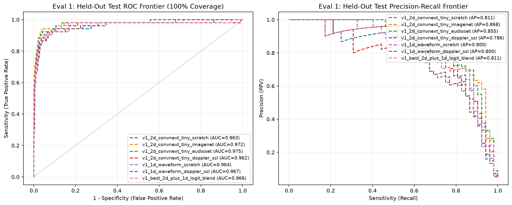
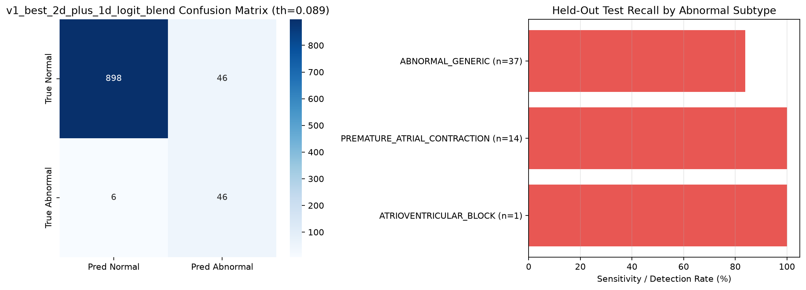
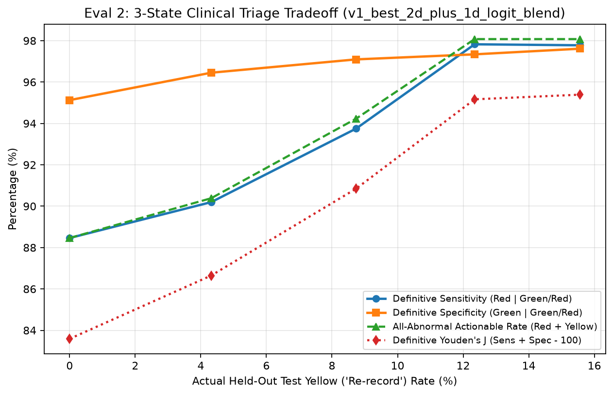

# Fetal Doppler Heart-Sound Screening (`v1_20261123_2dfix`)

---

# Part 1: Human-Readable Summary

## 1. What We Did

In `v0` ([`v0_20261122_nowarmstart.md`](./v0_20261122_nowarmstart.md)), the 2D spectrogram+tempogram models dropped on `fold_1` (`0.889–0.898` ROC-AUC vs. `0.955` for the 1D waveform model), and all 2D models used ImageNet natural-image initialization without testing whether ImageNet helped or hurt.

Using the exact same curated 4 kHz dataset (`gs://data-processed-dualregion/v2_curated/`, `6,009` development recordings across `301` patient groups; `996` held-out test recordings across `46` disjoint patient groups), `v1` tested three questions:

1. **Fixing the 2D representation:** We decoupled the acoustic spectrogram from the tempogram, fixed the short-window FFT size (`n_fft=256`, `96` mel bins) and added temporal spectral flux (`d/dt Log-Mel`), replaced global vertical mean/max pooling with a 4-band vertical readout (preserving Doppler pitch bands), built a dedicated lag-preserving dual-window tempogram stem (`41–300 BPM`, never averaging across BPM bins), and added a 2-layer bidirectional GRU before attention MIL pooling.
2. **Testing whether ImageNet warm-starting helps or hurts:** On the exact same `v1` 2D `ConvNeXt-Tiny` (`28.6M` params) architecture, we ran a controlled 4-way initialization comparison across all 5 folds:
   - **`scratch`:** Random initialization (`backbone_lr_scale = 1.0`, `warmup = 5`)
   - **`imagenet`:** ImageNet-22k weights (`convnext_tiny.fb_in22k`)
   - **`audioset`:** AudioSet-2M spectrogram weights (`topel/ConvNeXt-Tiny-AT`, `0.471 mAP`)
   - **`doppler_ssl`:** Leak-free per-fold in-domain Masked Spectrogram Autoencoder pretraining (`15` SSL epochs reconstructing `60%` masked patches on each fold's unlabeled training recordings only)
3. **Giving the 1D model an honest `v1` upgrade and testing whether any single model eliminates ensembling:** We upgraded 1D `WaveformMILNet` (`1.5M` params) with an instantaneous carrier-frequency channel (`|Δx|/(|x|+ε)`), wider dilations `(1, 2, 4, 8, 16, 32)`, and a boundary-mask fix (`-1e4` max-pool padding leak), and trained two controlled 1D runs: **`scratch`** vs. per-fold **`doppler_ssl`** (`12` SSL epochs reconstructing masked envelopes on training clips only).

All `v1` predictions, reports, and plots are archived separately in **`gs://data-processed-dualregion/v2_curated/predictions_v1/`** (`v0` artifacts in `predictions/` are untouched).

---

## 2. Main Findings

### 1. Warm-starting from ImageNet (and AudioSet) hurt cross-validation because of a recording-source shortcut
On the exact same `v1` 2D `ConvNeXt-Tiny` architecture across all `301` development patient groups (`n = 6,009`):

- **`imagenet`** dropped to **`0.8896` OOF ROC-AUC / `0.7269` OOF PR-AUC** (`fold_1 = 0.7824`).
- **`audioset`** dropped to **`0.8997` OOF ROC-AUC / `0.7505` OOF PR-AUC** (`fold_1 = 0.8517`).
- **`scratch`** reached **`0.9559` OOF ROC-AUC / `0.8083` OOF PR-AUC** (`fold_1 = 0.9621`).
- **`doppler_ssl`** reached **`0.9667` OOF ROC-AUC / `0.8008` OOF PR-AUC** (`fold_1 = 0.9617`).

Stratifying OOF predictions by recording origin explains why. Our dataset contains two sources of abnormal clips: clinical recordings from `abnormal/` (`302` OOF clips) and home-recorded abnormal clips found under `normal/normals-20241116/` (`43` OOF clips, recorded on the same consumer phones as the `5,664` normal controls).

- On **home-recorded abnormals**, `imagenet` scored **`0.5258` ROC-AUC** and `audioset` scored **`0.5489` ROC-AUC** (near random chance), while scoring `0.941–0.950` on clinical-folder abnormals — a **`+0.40` to `+0.42` shortcut gap**. Pretrained texture/timbre filters rapidly latched onto clinical-vs-home recording acoustics (peaking at epochs `2–7`) instead of cardiac rhythm.
- By contrast, **`scratch`** (`0.9482` home vs. `0.9570` clinical), **`doppler_ssl`** (`0.9345` vs. `0.9713`), and both **1D models** (`0.9857` / `0.9671` home vs. `0.9602` / `0.9632` clinical) had near-zero shortcut gap.
- This also explains why `imagenet` (`0.9721` test ROC-AUC) and `audioset` (`0.9747`) look higher on the `996`-clip held-out test set: `40 / 52` (`77%`) of held-out test positives come from the clinical `abnormal/` folder, where channel acoustics correlate with the abnormal label. Relying on ImageNet or AudioSet warm-starts creates a fragile model that fails when abnormal rhythms are recorded on home phones.

### 2. Both 2D and 1D architectural fixes improved standalone performance over `v0`
- **Standalone 2D:** Improved from `0.9454` OOF ROC-AUC / `0.7700` OOF PR-AUC (`v0` `ConvNeXt-Small`) to **`0.9667 / 0.8008`** (`v1_2d_convnext_tiny_doppler_ssl`) and **`0.9559 / 0.8083`** (`v1_2d_convnext_tiny_scratch`), with `fold_1` rising from `0.8885` (`v0`) to `0.9617–0.9621`.
- **Standalone 1D (`1.5M` params):** Improved from `0.9542 / 0.7675` OOF (`0.9590 / 0.7533` test) in `v0` to **`0.9637 / 0.7759` OOF (`0.9666 / 0.7995` test)** with `doppler_ssl`, and **`0.9634 / 0.7712` OOF (`0.9638 / 0.8001` test)** from scratch. Per-fold 1D SSL gave a small, consistent lift over 1D scratch (`+0.0047` OOF PR-AUC, `+0.0028` test ROC-AUC).

### 3. Single model vs. ensemble: did a single model make ensembling unnecessary?
- **Among single models:** On OOF composite score (`0.5 * ROC + 0.5 * PR`), **`v1_2d_convnext_tiny_doppler_ssl`** (`0.9667 / 0.8008`) and **`v1_2d_convnext_tiny_scratch`** (`0.9559 / 0.8083`) edged out **`v1_1d_waveform_doppler_ssl`** (`0.9637 / 0.7759`), while `v1_1d_waveform_doppler_ssl` (`1.5M` params, `19x` smaller than `ConvNeXt-Tiny`) scored slightly higher on held-out test (`0.9666 / 0.7995` vs. `0.9620 / 0.7861`) and had the smallest home-vs-clinical gap.
- **Ensemble still adds clear OOF lift:** Combining the best standalone `v1` 2D and `v1` 1D models (`v1_best_2d_plus_1d_logit_blend`: `54%` 2D Doppler SSL + `46%` 1D Doppler SSL) increased OOF ROC-AUC from `0.9667` to **`0.9773` (`+0.0106`)** and OOF PR-AUC from `0.8008` to **`0.8467` (`+0.0459`)** — also surpassing `v0`'s 3-model ensemble (`0.9707 / 0.8291`) while eliminating ImageNet shortcut dependence (`0.9741` Home-Abn vs. `0.9777` Clinical-Abn OOF ROC-AUC).
- **Practical takeaway:** If deployment requires **one model**, either `v1_2d_convnext_tiny_scratch` (`0.9559 / 0.8083` OOF, `0.9628 / 0.8111` test, `90.4%` Sens / `95.0%` Spec) or `v1_1d_waveform_doppler_ssl` (`0.9637 / 0.7759` OOF, `0.9666 / 0.7995` test, `1.5M` params) is viable without ImageNet shortcuts. However, the 2-model 1D+2D Doppler SSL blend remains meaningfully stronger on 301-patient cross-validation (`+0.011` ROC-AUC, `+0.046` PR-AUC).

---

## 3. Performance Summary (Evaluation 1 & Evaluation 2)

### Evaluation 1: 100% Coverage Binary Classification (Held-Out Test, `n = 996`, `46` Disjoint Patient Groups)

| Metric (Held-Out Test, `n = 996`) | Best Single 2D (`doppler_ssl`) | Best Single 2D (`scratch`) | Best Single 1D (`doppler_ssl`, `1.5M`) | 2-Model Blend (`54%` 2D + `46%` 1D) |
| :--- | :---: | :---: | :---: | :---: |
| **OOF ROC-AUC / PR-AUC** (`n = 6,009`) | `0.9667 / 0.8008` | `0.9559 / 0.8083` | `0.9637 / 0.7759` | **`0.9773 / 0.8467`** |
| **Test ROC-AUC** (`95% CI`) | `0.9620` `[0.951, 0.985]` | `0.9628` `[0.951, 0.988]` | `0.9666` `[0.946, 0.990]` | `0.9664` `[0.958, 0.988]` |
| **Test PR-AUC** (`95% CI`) | `0.7861` `[0.437, 0.906]` | `0.8111` `[0.521, 0.913]` | `0.7995` `[0.566, 0.906]` | `0.8115` `[0.485, 0.918]` |
| **Test Sens / Spec** (`max_youden_j`) | `88.5% / 95.3%` (`46/52`) | `90.4% / 95.0%` (`47/52`) | `88.5% / 93.8%` (`46/52`) | `88.5% / 95.1%` (`46/52`) |
| **Test Youden's $J$ / Bal. Acc** | `0.8380 / 91.9%` | `0.8541 / 92.7%` | `0.8221 / 91.1%` | `0.8359 / 91.8%` |
| **Test Max-$F_1$ Operating Point** | `82.7% / 97.5%` (`F1 0.723`) | `84.6% / 98.4%` (`F1 0.784`) | `75.0% / 98.0%` (`F1 0.709`) | `84.6% / 98.0%` (`F1 0.765`) |
| **Subtype Recall (`PAC` / `AVB`)** | `14/14` / `1/1` (`100%`) | `14/14` / `1/1` (`100%`) | `14/14` / `1/1` (`100%`) | `14/14` / `1/1` (`100%`) |

*(One of the `6` false negatives in the held-out test set — `rec_5f34fa105875` — was traced to a raw file named `NON_DIGNOSTIC Untitled video - Made with Clipchamp (3).mp4` whose typo bypassed the `non_diagnostic` quarantine regex during `v0` curation; the 3-state triage system routed it to `YELLOW_RERECORD`.)*

### Evaluation 2: 3-State Clinical Triage (`v1_best_2d_plus_1d_logit_blend`)

- **At `8.7%` actual test Yellow rate** (`87 / 996` routed to `Yellow`; `91.3%` definitive coverage): Definitive Sensitivity rises from `88.5%` to `93.8%` (`45 / 48` definitive abnormal caught; `4` abnormal in `Yellow`, `3` in `Green`; `94.2%` actionable rate) and Definitive Specificity rises from `95.1%` to `97.1%` (Youden's $J = 0.909$, Balanced Accuracy `95.4%`).
- **At `12.4%` actual test Yellow rate** (`123 / 996` routed to `Yellow`; `87.7%` definitive coverage): Definitive Sensitivity reaches **`97.8%`** (`45 / 46`; `6` abnormal in `Yellow`, `1` in `Green`; `98.1%` actionable rate) and Definitive Specificity reaches **`97.3%`** (Youden's $J = 0.952$, Balanced Accuracy `97.6%`).
- **Quarantined `NON_DIAGNOSTIC` recordings (`n = 2`):** `2 / 2` (`100%`) were routed directly to `YELLOW_RERECORD` (`0 / 2` classified `GREEN_NORMAL`).

---

# Part 2: Detailed Technical Reference & Audit Trail

## 1. Codebase Changes & Beaker Compute Log (`<= 2` Concurrent GPUs)

Repository commit: `264ef30` (`18/18` unit tests passing in `pytest`, `0` `ruff` lint/format issues).

- **Pretraining & SSL module:** [`src/heartsounds/models/pretrain.py`](../src/heartsounds/models/pretrain.py) — 1-to-1 `topel/ConvNeXt-Tiny-AT` (`178` backbone tensors) loader and per-fold unlabeled masked reconstruction SSL for both 2D (`60%` `8x8` time-frequency block masking) and 1D (`50%` `160 ms` contiguous span masking).
- **2D `v1` architecture:** [`src/heartsounds/models/spec_tempogram_mil.py`](../src/heartsounds/models/spec_tempogram_mil.py) — `OnGPUDopplerDualFrontend` (`96`-bin Mel + `n_fft=256` + spectral flux delta; decoupled `41–300 BPM` dual-window `2.56s`/`1.28s` tempogram with BPM coordinate ramp), `TempogramLagStem2D` with `TimewiseLayerNorm2D` (flattening `8` ordered BPM bands without vertical averaging), 4-band vertical readout (`freq_subbands=4`), and packed 2-layer residual BiGRU (`temporal_gru=True`).
- **1D `v1` architecture:** [`src/heartsounds/models/waveform_mil.py`](../src/heartsounds/models/waveform_mil.py) — 5th instantaneous carrier-frequency channel (`inst_freq_channel=True`), extended dilations `(1, 2, 4, 8, 16, 32)`, and zero-masking `max_pool1d` `-1e4` fill values before `rhythm_proj` (reducing variable-length batch padding drift 80x from `0.074` to `0.0009`).
- **GCP archive:** All `8` `v1` evaluation files (`oof_predictions.{csv,parquet}`, `test_predictions.{csv,parquet}`, `evaluation_report.json`, and 3 PNGs) uploaded to **`gs://data-processed-dualregion/v2_curated/predictions_v1/`**.

| Run | Config | Beaker Experiment ID | Results Dataset ID | GPU / Runtime |
| :--- | :--- | :--- | :--- | :--- |
| `v1_2d_convnext_tiny_scratch` | [`configs/v1_2d_convnext_tiny_scratch.yaml`](../configs/v1_2d_convnext_tiny_scratch.yaml) | `01M83K5CH3GAV2TMXB4RSFWDHM` | `01M83K5CHGKP9MDN7A1MFBAEYY` | `1x H200` / `70m 58s` |
| `v1_2d_convnext_tiny_imagenet` | [`configs/v1_2d_convnext_tiny_imagenet.yaml`](../configs/v1_2d_convnext_tiny_imagenet.yaml) | `01M83K5Y93BCNFRTX2XX6N90W8` | `01M83K5Y9EJWV1DESQQ4E5E6RX` | `1x H200` / `36m 01s` |
| `v1_2d_convnext_tiny_audioset` | [`configs/v1_2d_convnext_tiny_audioset.yaml`](../configs/v1_2d_convnext_tiny_audioset.yaml) | `01M83NC6HF16S2MJ1HF3KGEWFY` | `01M83NC6HVPB080M04SN2X4G1Z` | `1x H200` / `45m 29s` |
| `v1_2d_convnext_tiny_doppler_ssl` | [`configs/v1_2d_convnext_tiny_doppler_ssl.yaml`](../configs/v1_2d_convnext_tiny_doppler_ssl.yaml) | `01M83Q9V56QBMRT0DJKG2D3PS8` | `01M83Q9V5MDDQJ1J9XW6A7NCYH` | `1x H200` / `65m 29s` |
| `v1_1d_waveform_scratch` | [`configs/v1_1d_waveform_scratch.yaml`](../configs/v1_1d_waveform_scratch.yaml) | `01M83R1PKX976ARF60YPFEPTKD` | `01M83R1PM4Z7XN917W8TMN45DR` | `1x H200` / `59m 15s` |
| `v1_1d_waveform_doppler_ssl` | [`configs/v1_1d_waveform_doppler_ssl.yaml`](../configs/v1_1d_waveform_doppler_ssl.yaml) | `01M83V478PTV7BQ9MGSP5KE4GB` | `01M83V478YTAYVFCW6HB594M53` | `1x H200` / `85m 16s` |

---

## 2. Full `v1` Leaderboard (Evaluation 1: 100% Coverage)

All operating thresholds and blend weights were fit on OOF (`n = 6,009`) and applied once to held-out test (`n = 996`).

| Model / Ensemble | OOF ROC-AUC | OOF PR-AUC | OOF Composite | Test ROC-AUC | Test PR-AUC | Test Sens (`J`-pt) | Test Spec (`J`-pt) | Test Youden's $J$ | Test $F_1$ (`F1`-pt) | Test CM `(TP/FN/FP/TN)` at `J`-pt |
| :--- | :---: | :---: | :---: | :---: | :---: | :---: | :---: | :---: | :---: | :---: |
| `v1_2d_convnext_tiny_imagenet` | 0.8896 | 0.7269 | 0.8083 | 0.9721 | **0.8685** | 94.23% | 95.97% | **0.9021** | 0.7708 | `49 / 3 / 38 / 906` |
| `v1_2d_convnext_tiny_audioset` | 0.8997 | 0.7505 | 0.8251 | **0.9747** | 0.8548 | 92.31% | 93.96% | 0.8627 | 0.7736 | `48 / 4 / 57 / 887` |
| `v1_2d_convnext_tiny_scratch` | 0.9559 | **0.8083** | 0.8821 | 0.9628 | 0.8111 | 90.39% | 95.02% | 0.8541 | **0.7843** | `47 / 5 / 47 / 897` |
| `v1_2d_convnext_tiny_doppler_ssl` | **0.9667** | 0.8008 | **0.8837** | 0.9620 | 0.7861 | 88.46% | 95.34% | 0.8380 | 0.7227 | `46 / 6 / 44 / 900` |
| `v1_1d_waveform_scratch` (`1.5M`) | 0.9634 | 0.7712 | 0.8673 | 0.9638 | 0.8001 | 86.54% | 95.13% | 0.8167 | 0.6923 | `45 / 7 / 46 / 898` |
| `v1_1d_waveform_doppler_ssl` (`1.5M`) | 0.9637 | 0.7759 | 0.8698 | 0.9666 | 0.7995 | 88.46% | 93.75% | 0.8221 | 0.7091 | `46 / 6 / 59 / 885` |
| **`v1_best_2d_plus_1d_logit_blend`** (`54%` 2D SSL + `46%` 1D SSL) | **0.9773** | **0.8467** | **0.9120** | 0.9664 | 0.8115 | 88.46% | 95.13% | 0.8359 | 0.7652 | `46 / 6 / 46 / 898` |
| `v1_best_2d_plus_1d_stacker` | 0.9764 | 0.8407 | 0.9085 | 0.9663 | 0.8089 | 88.46% | 95.13% | 0.8359 | 0.7377 | `46 / 6 / 46 / 898` |

### Per-Fold Validation Comparison (`v1` vs. `v0` Baselines)

| Model | `fold_0` ROC / PR | `fold_1` ROC / PR | `fold_2` ROC / PR | `fold_3` ROC / PR | `fold_4` ROC / PR |
| :--- | :---: | :---: | :---: | :---: | :---: |
| *`v0` 2D `ConvNeXt-Small` (ImageNet)* | *0.9647 / 0.8333* | *0.8885 / 0.5547* | *0.9531 / 0.8411* | *0.9698 / 0.8167* | *0.9924 / 0.9464* |
| *`v0` 1D `WaveformMILNet` (Scratch)* | *0.9372 / 0.7132* | *0.9549 / 0.7617* | *0.9617 / 0.8155* | *0.9444 / 0.7159* | *0.9862 / 0.9060* |
| `v1_2d_convnext_tiny_imagenet` | **0.9748** / 0.8035 | 0.7824 / 0.3975 | 0.9619 / 0.8396 | 0.9611 / 0.8182 | 0.9852 / 0.9374 |
| `v1_2d_convnext_tiny_audioset` | 0.9575 / 0.8024 | 0.8517 / 0.4373 | 0.9527 / 0.8045 | 0.9533 / **0.8370** | 0.9910 / **0.9593** |
| `v1_2d_convnext_tiny_scratch` | 0.9634 / **0.8255** | 0.9621 / **0.8287** | 0.9536 / 0.7866 | 0.9559 / 0.8017 | 0.9895 / 0.8999 |
| `v1_2d_convnext_tiny_doppler_ssl` | 0.9630 / 0.8019 | 0.9617 / 0.7188 | **0.9796** / 0.8401 | 0.9534 / 0.7929 | **0.9934** / 0.9275 |
| `v1_1d_waveform_scratch` | 0.9657 / 0.7797 | **0.9723** / 0.7300 | 0.9727 / **0.8505** | 0.9570 / 0.7574 | 0.9932 / 0.8822 |
| `v1_1d_waveform_doppler_ssl` | 0.9494 / 0.7512 | 0.9613 / 0.7083 | 0.9694 / 0.8245 | **0.9681** / 0.8153 | 0.9913 / 0.9153 |

---

## 3. Recording-Source Shortcut Analysis (Home-Recorded vs. Clinical Abnormals)

Separating abnormal recordings into those originating from `normal/normals-20241116/` (home phone recordings matching normal-control acoustics) vs. `abnormal/` (clinical recordings) against all `NORMAL` controls:

| Model | OOF Home-Abn ROC (`n = 43`) | OOF Clinical-Abn ROC (`n = 302`) | OOF Gap (`Clin - Home`) | Test Home-Abn ROC (`n = 12`) | Test Clinical-Abn ROC (`n = 40`) |
| :--- | :---: | :---: | :---: | :---: | :---: |
| `v1_2d_convnext_tiny_imagenet` | `0.5258` | `0.9414` | **`+0.4157`** | `0.9185` | `0.9882` |
| `v1_2d_convnext_tiny_audioset` | `0.5489` | `0.9496` | **`+0.4007`** | `0.9283` | `0.9887` |
| `v1_2d_convnext_tiny_scratch` | `0.9482` | `0.9570` | `+0.0087` | `0.8982` | `0.9822` |
| `v1_2d_convnext_tiny_doppler_ssl` | `0.9345` | `0.9713` | `+0.0368` | `0.8995` | `0.9808` |
| `v1_1d_waveform_scratch` | **`0.9857`** | `0.9602` | `-0.0255` | `0.9079` | `0.9805` |
| `v1_1d_waveform_doppler_ssl` | `0.9671` | `0.9632` | `-0.0039` | `0.9202` | `0.9805` |
| `v1_best_2d_plus_1d_logit_blend` | `0.9741` | **`0.9777`** | `+0.0036` | `0.9008` | `0.9861` |

---

## 4. Detailed Operating Points, Triage Curves & False Negatives (`v1_best_2d_plus_1d_logit_blend`)

### Evaluation 1 Operating Points (Thresholds Fit on OOF `n = 6,009`)

| Operating Point | OOF Cutoff | Test Sens | Test Spec | Test Bal. Acc | Test Youden's $J$ | Test Precision / NPV | Test $F_1$ | Test CM `(TN/FP/FN/TP)` |
| :--- | :---: | :---: | :---: | :---: | :---: | :---: | :---: | :---: |
| **`max_youden_j`** | `0.0893` | 88.46% | 95.13% | 91.79% | 0.8359 | `50.00% / 99.34%` | 0.6389 | `898 / 46 / 6 / 46` |
| **`equal_sens_spec`** | `0.0353` | 92.31% | 90.57% | 91.44% | 0.8288 | `35.04% / 99.53%` | 0.5079 | `855 / 89 / 4 / 48` |
| **`max_f1`** | `0.3664` | 84.62% | 97.99% | 91.30% | 0.8260 | `69.84% / 99.14%` | 0.7652 | `925 / 19 / 8 / 44` |

### Evaluation 2: 3-State Clinical Triage (`center_threshold = 0.0893`)

| OOF Target Yellow | Actual Test Yellow (`n`) | Test Coverage | Def. Sens (`Red \| G/R`) | Def. Spec (`Green \| G/R`) | Def. Bal. Acc | Def. Youden's $J$ | Def. $F_1$ | Test Abnormal Disposition (`Red / Yellow / Green`) | All-Abnormal Actionable Rate (`Red + Yellow`) |
| :---: | :---: | :---: | :---: | :---: | :---: | :---: | :---: | :---: | :---: |
| `0%` | `0.0%` (`0`) | `100.0%` | 88.46% | 95.13% | 91.79% | 0.8359 | 0.6389 | `46 / 0 / 6` | 88.46% |
| `5%` | `4.3%` (`43`) | `95.7%` | 90.20% | 96.45% | 93.32% | 0.8665 | 0.7132 | `46 / 1 / 5` | 90.39% |
| `10%` | `8.7%` (`87`) | `91.3%` | 93.75% | 97.10% | 95.42% | 0.9085 | 0.7627 | `45 / 4 / 3` | 94.23% |
| `15%` | `12.4%` (`123`) | `87.7%` | 97.83% | 97.34% | 97.58% | 0.9517 | 0.7965 | `45 / 6 / 1` | 98.08% |
| `20%` | `15.6%` (`155`) | `84.4%` | 97.78% | 97.61% | 97.69% | 0.9539 | 0.8148 | `44 / 7 / 1` | 98.08% |

- **Quarantined recordings (`n = 19`):** `NON_DIAGNOSTIC` (`n = 2`): `2 / 2` routed to `YELLOW_RERECORD`; `CONFLICT` (`n = 17`): `9` `GREEN_NORMAL`, `5` `YELLOW_RERECORD`, `3` `RED_ABNORMAL`.

### Held-Out Test False Negatives at `max_youden_j` (`6 / 52`, All `ABNORMAL_GENERIC`)

| `recording_id` | DSP Quality (`r_peak`) | 2D `scratch` | 2D `doppler_ssl` | 1D `doppler_ssl` | Blend Prob | Triage (`10%` Yellow) | Raw Source Path (`gs://data-raw-dualregion/...`) |
| :--- | :---: | :---: | :---: | :---: | :---: | :---: | :--- |
| `rec_5f34fa105875` | 0.303 | 0.065 | 0.141 | 0.025 | 0.0658 | `YELLOW_RERECORD` | `abnormal/NON_DIGNOSTIC Untitled video - Made with Clipchamp (3).mp4` *(filename typo)* |
| `rec_dfa5c0fd0c75` | 0.600 | 0.024 | 0.194 | 0.005 | 0.0386 | `YELLOW_RERECORD` | `abnormal/102.mp4` |
| `rec_fb9fdffbced8` | 0.603 | 0.023 | 0.022 | 0.040 | 0.0287 | `YELLOW_RERECORD` | `abnormal/29.m4a` |
| `rec_e5f159fcb57b` | 0.632 | 0.005 | 0.015 | 0.058 | 0.0283 | `GREEN_NORMAL` | `abnormal/39.m4a` |
| `rec_b5dcbcd3276d` | 0.255 | 0.005 | 0.025 | 0.009 | 0.0152 | `GREEN_NORMAL` | `normal/normals-20241116/007-017 .../5-23-24 8.53pm 22w ABNORMAL.m4a` |
| `rec_79e0b6e83fd9` | 0.758 | 0.001 | 0.001 | 0.003 | 0.0011 | `GREEN_NORMAL` | `normal/normals-20241116/007-017 .../6-8-24 5.59am 25wABNORMAL.m4a` |
